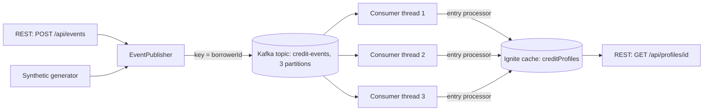

# credit-event-pipeline

A working demo of how a credit bureau keeps every person's credit file up to date in real time, built with
**Spring Boot, Apache Kafka, Apache Ignite and React**. The data is either randomly generated or replayed from a
public loan dataset, and this project is unrelated to any employer or client.

## What is this, in plain English?

Banks report facts about loans all day: a loan was opened, a payment arrived on time, a payment was late,
a loan was closed. A credit bureau has to turn that stream into one correct, up-to-date credit file per person,
even when millions of updates arrive at once and things go wrong.

This project does that, and shows it live in the browser:

1. **Updates arrive** and wait in sorted lanes (Kafka), so a sudden rush never overwhelms the system.
2. **Workers** take updates from the lanes, three at a time, and add each one to the right person's file.
3. **Credit files** live in a fast in-memory database (Ignite), are saved to disk, and are updated one
   indivisible step at a time, so two workers can never overwrite each other.
4. **A dashboard** explains all of it in plain English, with a switch to the real technical names.

It also keeps three promises when things go wrong: nothing is lost if the app restarts, nothing is counted
twice if an update arrives twice, and nothing disappears silently if an update cannot be processed.

<!-- Add your own screenshots to docs/ and uncomment these lines:


-->

## Architecture



Design points:

- **Ordering per borrower.** Events are keyed by `borrowerId`, so one borrower's events always land on
  the same partition and are applied in order.
- **Parallelism across borrowers.** The listener runs with `concurrency=3`, one thread per partition.
- **Atomic updates.** Profiles are updated with an Ignite `CacheEntryProcessor`, which runs atomically on
  the node that owns the key, so concurrent consumers never lose updates and no explicit locks are needed.

## Run it

Requirements: Java 17+, Maven, Docker.

```bash
docker compose up -d          # starts Kafka on localhost:9092
mvn spring-boot:run           # starts the app (Ignite starts embedded in the same JVM)
```

Ignite needs `--add-opens` flags on Java 17+. They are already configured in `pom.xml` for
`spring-boot:run` and for tests. If you run the jar directly, pass the same flags
(see `ignite.jvm.args` in `pom.xml`).

## Live dashboard

With the app running, open **http://localhost:8080/**. The page shows, live:

- events published to Kafka, processed, and still in flight, plus throughput in events per second
- how events spread across the Kafka partitions and the consumer threads handling them
- a feed of the most recently processed events (partition, offset, thread, borrower)
- borrower profiles as they build up in Ignite, with a lookup box and a "busiest borrowers" list

Use the 50,000 burst or "Trickle" mode to watch the flow instead of only the end result.

The dashboard is a single static page (`src/main/resources/static/index.html`) that reads the API below.

| Endpoint | What it returns |
|---|---|
| `POST /api/events/generate?count=&borrowers=` | publishes random events |
| `POST /api/events` | publishes one event |
| `GET /api/stats` | published, processed, cached profiles, processed per partition |
| `GET /api/recent` | most recently processed events, newest first |
| `GET /api/analytics` | portfolio totals and at-risk borrowers, computed with Ignite SQL |
| `GET /actuator/prometheus` | metrics in Prometheus format |
| `GET /api/profiles?limit=` | busiest borrowers |
| `GET /api/profiles/{borrowerId}` | one borrower's profile |

## Real-time dashboard and loan replay

**Live push.** The browser opens one Server-Sent Events connection to `GET /api/live`. `LiveBroadcaster` pushes the
headline numbers and the latest processed events four times a second, and only while someone is watching. If the
connection is not available the dashboard falls back to polling every second. The status badge shows **Live**
while the push connection is working.

**Replay of a public loan dataset.** `DatasetReplayer` reads a loans CSV as a stream and publishes each loan to
Kafka at a chosen speed (100 to 5,000 per second), starting again from the top when the file ends.

| Endpoint | What it does |
|---|---|
| `GET /api/live` | event stream of live snapshots |
| `GET /api/replay` | replay status (running, rate, sent, file) |
| `POST /api/replay/start?rate=500` | start replaying |
| `POST /api/replay/stop` | stop |

The repo ships `data/loans-sample.csv`, a **made-up** file with the same columns, so the button works straight away.
To replay the real public dataset:

1. Download the Lending Club loan data from Kaggle (search "Lending Club loan data", file `accepted_2007_to_2018Q4.csv`).
   Check the licence on the download page. Unzip it if it is compressed.
2. Put it in `data/` with a name that does not contain the word "sample", for example `data/lending-club.csv`.
   It is about 1.5 GB, so it is in `.gitignore` and must not be committed.
3. Start the app pointing at it:
   `mvn spring-boot:run "-Dspring-boot.run.arguments=--pipeline.replay.file=data/lending-club.csv"`
4. Click **Start replay** on the dashboard.

How a row becomes events: columns `id`, `loan_amnt`, `loan_status` are required, `installment` and `grade` are optional.
Each loan becomes `ACCOUNT_OPENED`, then payments, then `ACCOUNT_CLOSED` if the loan has ended. Be aware of two
simplifications: the dataset has one row per loan and no person id, so loans are spread over 5,000 made-up borrowers
by hashing the loan id; and it has no payment history, so payments are inferred from the final loan status
(Fully Paid gives on-time payments, Charged Off gives delayed ones). The loans are real; the borrower grouping and the
payment timeline are not.

## Sharing a live demo

Build the dashboard (`cd dashboard && npm run build`), start the app, then run
`cloudflared tunnel --url http://localhost:8080` and share the printed link plus `/app/index.html`. Share only port 8080,
never Grafana. A single request can publish at most `pipeline.limits.max-generate` events (100,000 by default).

## SQL over the Ignite cache

`CreditProfile` fields are annotated with `@QuerySqlField`, and the cache is created with
`setIndexedTypes(...)` (see `IgniteConfig`). Ignite therefore exposes a SQL table called `CreditProfile`.

- "Busiest borrowers" (`GET /api/profiles?limit=8`) runs `SELECT _val FROM CreditProfile ORDER BY eventsApplied DESC LIMIT ?`
  against an indexed column, instead of scanning every entry.
- `GET /api/analytics` returns portfolio totals (`COUNT`, `SUM`) and the borrowers with more late payments
  than on-time ones, both computed by Ignite.

Note: SQL needs the `ignite-indexing` module, which needs H2 1.4.197. The pom pins `h2.version` for that reason.

## Reliability: duplicates, restarts and failures

Kafka delivers each event *at least once*, and a process can crash at any moment, so three things are handled:

| Problem | How it is handled |
|---|---|
| The same event arrives twice | Each profile remembers the IDs of its last 50 events. Checking the ID and updating the profile happen in one atomic Ignite entry processor, so a repeat is ignored. Counted in `pipeline_events_duplicates_total`. |
| The app restarts and the cache is empty | Ignite native persistence writes profiles to the `ignite-data/` folder. After a restart they are read back. Delete the folder to start from scratch. |
| An event keeps failing, or is not valid JSON | It is retried 3 times, then copied to the dead-letter topic `credit-events.DLT` and the consumer moves on. Counted in `pipeline_events_dead_lettered_total`. |

Together: persistence keeps the data, at-least-once delivery means events can be replayed after a crash, and the
ID check makes a replay harmless.

Limits: only the last 50 event IDs per borrower are remembered, so a duplicate that arrives after 50 newer events
for the same borrower is not caught. Dead-lettered events are kept for inspection but not replayed automatically.

Try it (PowerShell: use `curl.exe`):

```bash
# 1. Duplicate: send the same event twice. The profile should show 1 event, and the duplicates counter goes up.
curl.exe -X POST localhost:8080/api/events -H "Content-Type: application/json" -d "{\"eventId\":\"demo-1\",\"borrowerId\":\"B999999\",\"lenderId\":\"L001\",\"type\":\"ACCOUNT_OPENED\",\"amount\":1000,\"occurredAt\":\"2026-10-25T10:00:00Z\"}"
curl.exe -X POST localhost:8080/api/events -H "Content-Type: application/json" -d "{\"eventId\":\"demo-1\",\"borrowerId\":\"B999999\",\"lenderId\":\"L001\",\"type\":\"ACCOUNT_OPENED\",\"amount\":1000,\"occurredAt\":\"2026-10-25T10:00:00Z\"}"
curl.exe localhost:8080/api/profiles/B999999

# 2. Restart: stop the app (Ctrl+C), start it again, then ask for the same profile. It is still there.
curl.exe localhost:8080/api/profiles/B999999

# 3. Dead letter: type a line that is not JSON, then press Enter and Ctrl+C.
docker exec -it ccp-kafka /opt/kafka/bin/kafka-console-producer.sh --bootstrap-server localhost:9092 --topic credit-events
# ...and read it back from the dead-letter topic:
docker exec ccp-kafka /opt/kafka/bin/kafka-console-consumer.sh --bootstrap-server localhost:9092 --topic credit-events.DLT --from-beginning --timeout-ms 5000
```

## Monitoring with Prometheus and Grafana

The app publishes metrics at `http://localhost:8080/actuator/prometheus`. `docker compose up -d` also starts:

| Tool | URL | Role |
|---|---|---|
| Prometheus | http://localhost:9090 | Scrapes the app every 5 s and stores the numbers as time series |
| Grafana | http://localhost:3000 | Draws the "Credit Event Pipeline" dashboard from Prometheus |

Custom metrics: `pipeline_events_published_total`, `pipeline_events_processed_total{partition}`,
`pipeline_event_processing_seconds` (histogram), `pipeline_events_in_flight`, `pipeline_profiles_cached`.
JVM, CPU and HTTP metrics come for free from Spring Boot. Grafana has no login in this setup, which is only
acceptable for local use.

## Continuous integration

`.github/workflows/ci.yml` runs `mvn verify` (unit and Kafka integration tests) and builds the React dashboard
on every push and pull request.

## React dashboard (optional, for learning)

`dashboard/` holds a React + TypeScript version of the live dashboard, with a list of practice tasks.
See `dashboard/README.md` for setup. After `npm run build` in that folder, Spring serves it at
`http://localhost:8080/app/index.html`.

Try it:

```bash
# publish 5,000 random events across 200 borrowers
curl -X POST "localhost:8080/api/events/generate?count=5000&borrowers=200"

# read a borrower's profile
curl localhost:8080/api/profiles/B000007

# pipeline stats
curl localhost:8080/api/stats
```

Submit a single event:

```bash
curl -X POST localhost:8080/api/events -H "Content-Type: application/json" -d '{
  "eventId": "e1", "borrowerId": "B000001", "lenderId": "L001",
  "type": "ACCOUNT_OPENED", "amount": 250000, "occurredAt": "2026-10-22T10:00:00Z"
}'
```

Event types: `ACCOUNT_OPENED`, `PAYMENT_ON_TIME`, `PAYMENT_DELAYED`, `ACCOUNT_CLOSED`.

## Tests

```bash
mvn test
```

- `ProfileServiceTest` checks profile logic and that 2,000 concurrent updates to one borrower are not lost.
- `PipelineIntegrationTest` runs the full path (Kafka, then the consumer, then Ignite) against an embedded Kafka broker.

## Ideas to extend it

- Add a dead-letter topic and retry policy for bad events.
- Persist the cache to a database with Ignite's cache store, or add a second node and show rebalancing.
- Add Micrometer metrics (events/sec, consumer lag) and a Grafana dashboard.
- Benchmark consumer concurrency and batch size and record the results here.
